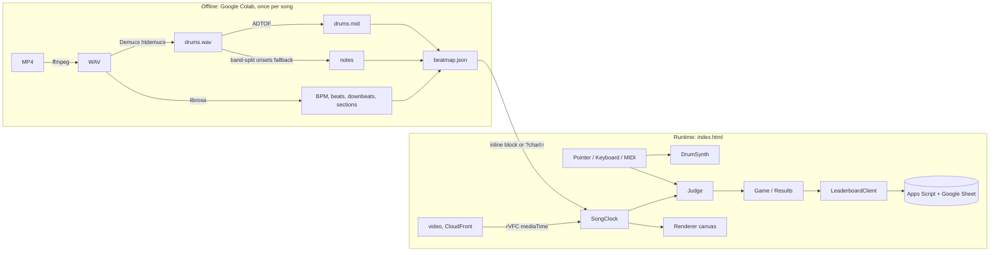
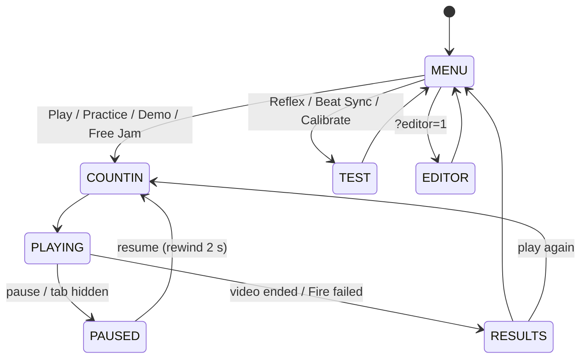
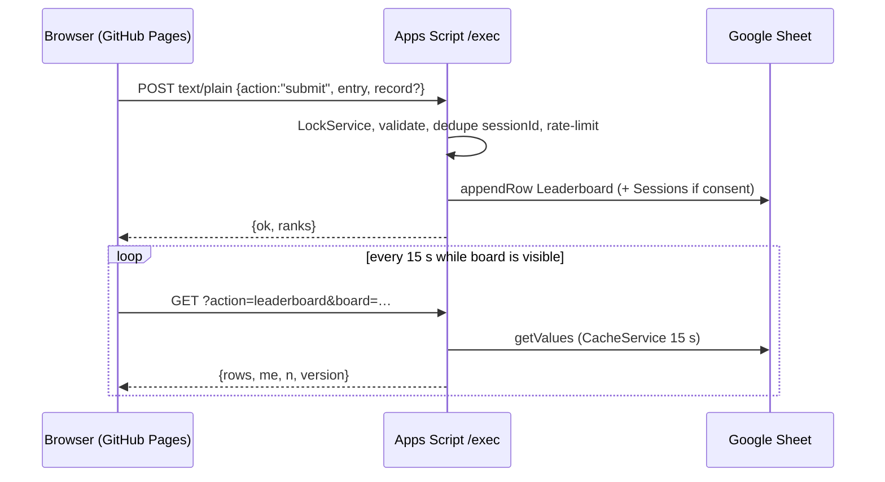

# intelliCARE Music Play-a-Long — Technical and Scientific Manual

**Version** 1.0.0-s2 · **Date** 22 November 2026 · **Institution** Republic Polytechnic, School of Sports & Health · **Author** _[author name]_ · **Licence** _[to be decided]_

Song 2: **翎羽悸動 | Fluttering Feathers, Stirring Hearts**, performed by **Selina Goh 吴宛颖**.

- **Play:** <https://aaron-chen-angus.github.io/intellicare-playalong-selina01/>
- **Live dashboard:** <https://script.google.com/macros/s/AKfycbz36Ssxqygb_53uIEsL1E3pE1a5KBCXIydbvJQqSDQCwmgxk5D_NuR7t4PXkjxzvnjv/exec?action=dashboard>
- **Open data (anonymised):** `…/exec?action=export` (CSV, one row per run) · `…/exec?action=export&kind=tests` · `…/exec?action=stats` (JSON)
- **Other songs in the series:** see "♪ More songs" on the menu (`Config.OTHER_SONGS`).

This app is a port of Song 1 of the intelliCARE Play-a-Long series and keeps all of its features. Song-specific parts (chart, theme, storage scope, backend) are described in §3, §4.0, §12–13 and Appendices B and F. The performer's image, name and performance video are used with permission; third-party marks visible in the photos (for example on the drum kit) belong to their owners.

---

## Abstract

intelliCARE Music Play-a-Long is a browser-based, gamified finger-drumming activity. Its target users are community seniors, students and the general public. A participant watches a music-performance video and plays along on five on-screen pads (kick, snare, hi-hat, tom and cymbal), guided by falling note "gems" on a perspective highway. The drum part of each song is transcribed offline: Hybrid Transformer Demucs separates the drums (Rouard et al., 2023), ADTOF transcribes them (Zehren et al., 2021, 2023) with a spectral-flux onset fallback (Bello et al., 2005), and librosa estimates the beat grid (Ellis, 2007; McFee et al., 2015). At runtime the application interpolates a song clock from the video's presentation timestamps, judges each tap against timing windows, synthesises drum sounds with the Web Audio API (W3C, 2021), and records timing metrics derived from the sensorimotor-synchronisation literature (Repp, 2005; Repp & Su, 2013). Two short assessments are included. A Reflex Test measures simple and four-choice reaction time, following the general protocol of Der and Deary (2006). A Beat Sync Test adapts paced tapping from BAASTA (Dalla Bella et al., 2017, 2024). Results can be compared with cohort percentiles and, once verified values are entered, with literature reference values. A Google Apps Script back end supplies a shared live leaderboard and aggregated cohort norms. Every composite index in the application is a heuristic engagement measure, not a validated psychometric scale. The application is not a medical or clinical assessment.

## Table of contents

1. Introduction · 2. Scientific background · 3. System overview · 4. Audio analysis pipeline · 5. Real-time engine · 6. Judging, scoring and gamification · 7. Performance metrics · 8. Reflex and Beat Sync tests · 9. Normative comparison · 10. Validity, reliability and limitations · 11. Data protection and ethics · 12. Architecture · 13. Deployment · 14. User and facilitator guide · 15. Testing and QA · 16. Maintenance and roadmap · References · Appendices A–F

**List of figures.** Fig. 1 Offline/runtime architecture · Fig. 2 Game state machine · Fig. 3 Leaderboard data flow · Fig. 4 Portrait and landscape layouts

**List of equations.** (1) Song clock · (2) Jitter smoothing · (3) Highway projection · (4) Score per hit · (5) Maximum score · (6) Weighted accuracy · (7) Mean asynchrony · (8) Timing SD · (9) Phase · (10) Consistency R · (11) Rayleigh p · (12) Chord simultaneity · (13) Limb independence · (14) RT summary · (15) Rhythm Index · (16) Coordination Index · (17) z-score · (18) Cohort percentile rank · (19) Level from XP

### Glossary

| Term | Meaning |
|---|---|
| Pad / lane | One of five drum zones (KICK, SNARE, HI-HAT, TOM, CYMBAL) and its column on the highway |
| Gem / note | An expected hit `{t, l}` (time in seconds, lane) |
| Beatmap / chart | JSON file of notes, beats, downbeats and sections (Appendix A) |
| Asynchrony | Signed tap time minus target time, in ms (negative = early) |
| IBI / IOI | Inter-beat interval / inter-onset interval |
| Heartbeat Mode | The app's "Star Power": ×2 score for 8 bars |
| Plume note (翎羽音符) | A note in a Heartbeat phrase (rose outline). Stored as the data flag `bud: true` |
| Stray | A press with no note in range on any lane |
| Wrong-pad hit | A press on lane A while a note on lane B was within the GOOD window |

---

## 1. Introduction

**Purpose.** The application provides an enjoyable rhythm activity for intelliCARE community sessions. As a by-product of play, it collects simple timing measures that participants and facilitators can use to follow engagement and progress.

**Target users.** Community-dwelling seniors (the Gentle difficulty has wider windows and kick + snare only), students, and the general public on phones (portrait first), tablets and desktops.

**Scope.** One song per build (the launch song above). Charts are produced offline. Local profiles live on the device, with an optional shared Google Sheet leaderboard.

**Intended use and disclaimer.** The application is for recreation and engagement. Reaction-time and rhythm outputs are indicative only. They are affected by device latency (Section 10) and **must not be used for diagnosis, screening or clinical decisions**. Every results screen states: "For fun and engagement — not a medical or clinical assessment."

## 2. Scientific background

### 2.1 Sensorimotor synchronisation and finger tapping
Tapping in time with an isochronous pacing signal is the canonical paradigm of sensorimotor synchronisation (SMS). Adults typically tap slightly ahead of the beat (*negative mean asynchrony*), and they correct their timing continuously through phase and period error correction (Repp, 2005; Repp & Su, 2013). Variability of asynchronies indexes timing precision. Circular statistics, which treat each tap as a phase angle relative to the beat cycle, give a consistency measure that is robust to occasional large errors (Fisher, 1993). BAASTA operationalises these measures in a test battery (Dalla Bella et al., 2017), and its mobile version reports adult norms (Dalla Bella et al., 2024).

### 2.2 Reaction time
Simple reaction time (SRT, one stimulus and one response) and choice reaction time (CRT, several stimulus–response pairs) slow with age. CRT shows larger age effects, and sex differences appear in both mean RT and intra-individual variability (Deary & Der, 2005; Der & Deary, 2006; Dykiert et al., 2012). SRT latency also depends on hardware and procedure (Woods et al., 2015). Web and touchscreen platforms add tens of milliseconds of device-dependent delay (Anwyl-Irvine et al., 2021; Pronk et al., 2020).

### 2.3 Rhythm and ageing; music-based activity for older adults
Beat synchronisation changes across the lifespan, and musical experience moderates it (Thompson et al., 2015). Older adults show changes in timing error correction, especially at slower tempi (Pollok et al., 2023). Rhythm-based activity is a core element of neurologic music therapy techniques (Thaut & Hoemberg, 2014). The present application is not a therapeutic intervention, but it uses the same engaging rhythmic structure.

### 2.4 Gamification and motivation
Gamification is the use of game-design elements in non-game contexts (Deterding et al., 2011). Reviews report mostly positive but context-dependent effects (Hamari et al., 2014). The design draws on self-determination theory (Ryan & Deci, 2000). Competence is supported by graded difficulty, immediate feedback and coaching tips. Autonomy comes from free choice of mode and difficulty and from cosmetic choices. Relatedness comes from shared leaderboards and facilitator sessions. Flow (Csikszentmihalyi, 1990) is supported by matching challenge to skill through three difficulties, practice speed and section loops.

## 3. System overview

**Modes:** Play (scored), Practice (0.5×/0.75×/1× speed, section loop, A–B loop, no fail, not recorded), Free Jam (no notes), Demo (auto-play), Calibration, Reflex Test, Beat Sync Test, Chart Editor (`?editor=1`).


*Figure 1. Offline and runtime architecture.*


*Figure 2. Game state machine (`Game.state`).*

## 4. Audio analysis pipeline

### 4.0 Song 2 chart, as shipped (isolated stem → template NMF → grid → alignment)
The production team supplied an isolated drum stem (`sounds/翎羽悸動drums.wav`, 228.46 s, 44.1 kHz), so no source separation was needed. The chain runs in headless Edge (`tools/README.md`):

1. **Template NMF** (`analyze.html`). A 96-band log-frequency magnitude spectrogram $V$ (2048-point FFT, 10 ms hop) is factorised as $V \approx WH$ with KL-divergence multiplicative updates; the columns of $W$ are initialised from the five kit samples in `sounds/` and, in the last 40 % of iterations, are allowed to adapt but are pulled 50 % back to the sample template each step. Onsets are peak-picked on each activation row $H_k$. The templates come from the series' sample kit, not Selina's kit; template mismatch is a known error source (it made the tom row mirror the kick, see step 3).
2. **Tempo, metre and bars** (`chart.html`). Kick and snare onsets $t_i$ (weights $w_i$ = velocity) give the beat period $P$ that maximises the circular resultant $R(P) = \left|\sum_i w_i e^{2\pi i t_i/P}\right| / \sum_i w_i$, searched over 60–200 BPM in 0.001 BPM steps: **124.06 BPM**. The 4/4 downbeat phase is the one that best puts kicks on beats 1 and 3 and snares on 2 and 4 (score 477 vs ≤ −142 for the other phases).
3. **Grid snap and clean-up** (`build_chart.html`). The beat grid is corrected locally by the median kick/snare deviation over ±8 beats (correction 6–45 ms), each note is snapped to its 16th-note slot (±45 ms; the measured onset time is kept when within 30 ms), and crosstalk is removed: a tom on a kick or snare slot is dropped (248), a lone tom is relabelled kick (29), a cymbal is kept only on a downbeat as a crash (147 removed), 16th-note hi-hats are dropped (44). Notes outside the drum region (bars 16–109) are dropped.
4. **Alignment to the video.** With onset envelopes $a[n]$ (stem) and $b[n]$ (video soundtrack), 10 ms hop, z-normalised per window,
   $$ r[\ell] = \frac{1}{N}\sum_{n} a[n]\, b[n+\ell], \qquad \hat\ell = \arg\max_\ell r[\ell], $$
   refined by parabolic interpolation over the three points around the peak, computed in 20 s windows every 5 s over ±25 s. The 30 confident windows (r ≥ 0.5) agree on **video time = stem time − 0.537 s** (spread 2 ms, median peak r = 0.64), so the video is unedited and all notes are stored in video time (`offsetMs = 0`; `meta.alignment = {lagMs: −537, …}`).
5. **Difficulties.** Gentle = one note per beat on the quarter-note slots (kick preferred on 1 and 3, snare on 2 and 4; in the half-time bridge an "and" kick may replace an empty beat; ≥ 300 ms between notes on the same pad). Groove = kick and snare on 8th notes (snare ghost notes with velocity < 0.6 dropped), hi-hat on beats, crashes. Fire = every cleaned note.

| Difficulty | Notes | Kick | Snare | Hi-hat | Tom | Cymbal | maxScore (1200·N − 18000) |
|---|---|---|---|---|---|---|---|
| Gentle | 356 | — | — | — | — | — | 409,200 |
| Groove | 816 | — | — | — | — | — | 961,200 |
| Fire (= full) | 1135 | 279 | 267 | 579 | 0 | 10 | 1,344,000 |

**Structure (bars of 4 beats, video time ≈ stem time − 0.54 s):** intro without drums (bars 1–15, 0–31 s) · pickup fill (16) · verse groove (17–44: kick 1, 3, "and" of 3; snare 2 & 4; 8th hi-hats) · build (45–52: snare on 2, 3, 4) · chorus groove (53–72) · **bridge (73–80, half-time: kick on 1, "and" of 2, "and" of 4, snare only on 4 every other bar)** · chorus groove to the end (81–107) · ending fill and final hit (108–109). Section names are provisional until confirmed by ear in the Editor.

**QA (`beatmap.meta.qa`):** max lane rate 5 notes/s (gate ≤ 12), kick + snare share 0.481 (gate > 0.35), 87 of 92 groove bars have kick on 1 and snare on 2 or 4 (the rest are fills and bridge bars). **Sync check against the video soundtrack** (`sync_check.html`, kick onsets found directly in the video audio, 5 spots of 10 s): mean |error| 11.1 / 12.3 / 24.4 / 11.9 / 9.3 ms → **13.8 ms** (acceptance < 30 ms).

Sections 4.1–4.5 describe the Colab notebook (`tools/beatmap_pipeline.ipynb`), which remains the fallback when only the full mix is available.

### 4.1 Source separation
The stereo 44.1 kHz audio is separated into a drum stem and the remainder with Hybrid Transformer Demucs (`htdemucs`, `--two-stems=drums`; Rouard et al., 2023). Separation removes most vocal and instrumental onsets, which would otherwise cause false drum detections.

### 4.2 Automatic drum transcription
ADTOF (Zehren et al., 2021, 2023) is run on the drum stem to produce a MIDI file with five classes. General MIDI pitches map to lanes as follows (identical in the notebook and in `Config.GM`):

| Lane | GM pitches |
|---|---|
| kick | 35, 36 |
| snare | 37, 38, 39, 40 |
| tom | 41, 43, 45, 47, 48, 50 |
| hihat | 42, 44, 46 |
| cymbal | 49, 51, 52, 53, 55, 57, 59 |

ADTOF's command-line interface varies between versions, so the notebook tries it and falls back automatically. For a review of drum-transcription methods, see Wu et al. (2018).

### 4.3 Onset detection (fallback)
The drum stem is band-filtered (4th-order Butterworth): kick < 150 Hz, snare 180–2,500 Hz, hi-hat 7–16 kHz. For each band, librosa's onset-strength envelope (spectral flux, hop = 256 samples) is peak-picked with a per-band threshold δ (kick 0.08, snare 0.10, hi-hat 0.06) and a minimum gap (kick and snare 120 ms, hi-hat 70 ms) (Bello et al., 2005; McFee et al., 2015). A high-band onset whose ≥ 5 kHz energy is still above 50 % of its peak 400 ms later is labelled cymbal. Velocity is $v = \min(1, 0.4 + \hat e)$, where $\hat e$ is the onset strength normalised to the song maximum.

### 4.4 Beat and downbeat tracking
Beats come from librosa's dynamic-programming beat tracker (Ellis, 2007) on the 22.05 kHz mono mix. The downbeat phase $p \in \{0,1,2,3\}$ is the one that maximises mean low-band onset strength on beats $p, p+4, \dots$, which assumes 4/4 time. Sections come from agglomerative segmentation of beat-synchronous chroma + MFCC into $k = \mathrm{clip}(\mathrm{round}(D/25), 4, 10)$ segments, where $D$ is the song duration in seconds. Section names are provisional and should be corrected in the Editor.

### 4.5 Post-processing and difficulty derivation
Notes in the same lane within 30 ms are de-duplicated (the first is kept). If the beatmap does not contain pre-baked difficulties, the application derives them at load time (`Beatmap.derive*`):

| Difficulty | Rule |
|---|---|
| **Fire** | Full chart; minimum gap per lane 60 ms |
| **Groove** | tom → snare; a hi-hat note is kept only if within 40 ms of an 8th-note grid point; hi-hat within 40 ms of a cymbal is dropped; minimum gap per lane 110 ms |
| **Gentle** | kick, snare and tom (tom → snare) only; a note must be within 0.35 IBI of a beat; at most one note per beat, preferring kick on beats 1 and 3 and snare on beats 2 and 4, then the note closest to the beat; minimum gap 300 ms |

**Bud flags** (Heartbeat phrases): if the chart has none, every note in bars 8, 16, 24, … (every 8th bar) is flagged. **4-pad mode** maps tom → snare at runtime and re-applies a 60 ms gap. Notes on different lanes within 6 ms of each other are marked as **chords**.

**Placeholder chart.** Until a real chart is pasted in, the app generates a labelled rock beat at a fixed 100 BPM (IBI 0.6 s, first beat 0.5 s). It has 8th-note hi-hats, kick on beats 1 and 3 plus the "and" of 3, snare on 2 and 4, a crash every 4 bars, a tom fill in every 8th bar, and a new section every 8 bars. The menu shows "Placeholder chart".

### 4.6 Expected accuracy and manual correction
Transcription from a separated stem is usually strongest for kick, snare and hi-hat and weaker for toms and cymbals (Wu et al., 2018; Zehren et al., 2023). Separation artefacts, ghost notes and fills will cause errors, so every chart should be reviewed in the Chart Editor (`tools/README.md`): offset nudge, add/move/delete, tap-record, snap (off, 1/4, 1/8, 1/16, triplet), sections, bud flags and up to 60 undo steps.

## 5. Real-time engine

### 5.1 Song-clock model
`video.currentTime` updates coarsely, so the song clock interpolates between presentation anchors supplied by `requestVideoFrameCallback` (`metadata.mediaTime`). Where that API is missing, it samples `currentTime` every 50 ms instead.

$$t_\text{song}(t_\text{perf}) = m_a + \frac{t_\text{perf} - p_a}{1000}\,r - \frac{o_\text{user} + o_\text{chart}}{1000} \tag{1}$$

Here $m_a$ is the anchor media time (s), $p_a$ the anchor `performance.now()` (ms), $r$ the playback rate, and $o$ the offsets (ms). When a new frame arrives with media time $m$ and the prediction is $\hat m$:

$$m_a \leftarrow \begin{cases}\hat m + 0.2\,(m-\hat m) & |m-\hat m| < 30\ \text{ms}\\ m & \text{otherwise (seek or stall)}\end{cases} \tag{2}$$

On `play`, `pause`, `seeked`, `ratechange`, `waiting`, `ended` and `canplay`, the anchor snaps to `currentTime`. Input events are judged at `event.timeStamp`, which uses the same time base as `performance.now()`, so the judged time is the touch time rather than the time the handler ran.

### 5.2 Input pipeline and latency budget
Pads respond to `pointerdown` (multi-touch, pointer capture), never to `click`. The handler runs synchronously: synth voice → judge → FX queue. It never waits for the render loop. The AudioContext uses `latencyHint: "interactive"`. Keyboard: D/A = snare, F/S = hi-hat, J/L = tom, K/; = cymbal, Space/B/N = kick (repeats ignored). Optional Web MIDI note-on messages with velocity > 0 map through the GM table above.

| Stage | Typical magnitude | Source |
|---|---|---|
| Touch digitiser + OS event delivery | tens of ms, device-dependent | Pronk et al. (2020) |
| Browser event → handler | < 1–2 ms | — |
| Web Audio output (interactive) | device-dependent, often 10–40 ms | W3C (2021) |
| Bluetooth audio | about 150–300 ms (shown as advice in the app) | — |
| Display (for visual stimuli) | about 1–2 frames | Anwyl-Irvine et al. (2021) |

_The figures above are indicative; device testing is needed (Section 15)._

### 5.3 Calibration
The app schedules 16 clicks at 600 ms IOI (100 BPM) on the Web Audio clock, starting 1.2 s ahead, with a visual pulse. Click times are converted to the `performance.now()` base with `AudioContext.getOutputTimestamp()`. For each tap, the signed difference to the nearest click is taken, differences with |d| > 150 ms are discarded, and at least 8 valid taps are required. The **median** becomes `Settings.offsetMs`. A manual slider (−200 to +200 ms) is also provided.

### 5.4 Drum synthesis
All voices route voice gain → pad bus (user volume) → DynamicsCompressor (threshold −10 dB, ratio 4) → Analyser (FFT 256) → output. Every hit is humanised by ±3 % pitch and ±1.5 dB. A single 2 s white-noise buffer is reused.

| Voice | Recipe |
|---|---|
| Kick | sine 150 → 45 Hz over 120 ms; gain 1 → 0.001 over 450 ms; 3 ms noise click through a 3 kHz high-pass |
| Snare | triangle 185 Hz (0.6, 120 ms) + noise → HP 1.2 kHz → BP 3.5 kHz (0.9, 200 ms) |
| Hi-hat | 6 square oscillators at 40·{2, 3, 4.16, 5.43, 6.79, 8.21} Hz → BP 10 kHz → HP 7 kHz, 0.5 → 0 in 60 ms; choke group (a new hat cuts the previous one) |
| Tom | sine 120 → 80 Hz over 250 ms, 0.9 → 0 in 400 ms + 5 % noise |
| Cymbal | metallic bank + noise → HP 5 kHz; 2 ms attack, 0.6 → 0.001 over 1.6 s |

The video element is **never** connected to Web Audio, because `createMediaElementSource` on a cross-origin video without CORS outputs silence. The spectrum strip uses the pad-audio analyser instead.

### 5.5 Rendering
The highway is a Canvas 2D element with DPR capped at 2. For a note with progress $p = 1 - (t_n - t)/A$, where $A$ is the approach time (default 1.8 s, adjustable 1.0–3.0 s, multiplied by playback rate):

$$y = y_\text{hit}\,p^{1.6},\qquad f = 0.4 + 0.6\,\frac{y}{y_\text{hit}},\qquad s = 0.6 + 0.4\,\frac{y}{y_\text{hit}} \tag{3}$$

Lane x positions converge toward the centre by factor $f$; gems scale by $s$. Flat mode sets $f = s = 1$. Lane centres are measured from the pad elements on every resize, so gems land exactly above their pads. Gems are pre-rendered sprites, so no per-frame `shadowBlur` is needed. Particles use a pool of 400 objects, and ripples and texts are also pooled. Adaptive quality: after 30 consecutive frames over 20 ms, particle counts are halved and the spectrum is disabled; both recover after 120 good frames. `prefers-reduced-motion` disables screen shake, spectrum and blossoms.

**Layout.** In portrait, the grid rows are header 32 px → video 16:9 (max 40 dvh) → HUD 36 px → highway (min 22 vh) → pads (height min(24 dvh, 190 px), minimum 136 px). Pads are ≥ 64 px with 8 px gaps and the kick bar is ≥ 48 px. In landscape, the video takes about 62 % on the left with song information below, and the game column (≥ 340 px) sits on the right. When landscape height is under 480 px, the header is hidden. No game element is drawn over the video; `?debug=1` asserts this every frame.

## 6. Judging, scoring and gamification

| Judgement | Groove / Fire | Gentle | Points |
|---|---|---|---|
| PERFECT | ±45 ms | ±70 ms | 300 |
| GREAT | ±90 ms | ±130 ms | 200 |
| GOOD | ±135 ms | ±200 ms | 100 |
| MISS | note passes +GOOD unhit | same | 0, breaks combo |

- **Wrong pad.** If no note in the struck lane is within GOOD, the nearest unjudged note on another lane within GOOD becomes WRONG in Groove and Fire. That note is consumed, the combo breaks, and the confusion matrix records expected → played. In Gentle, the press is treated as harmless and the note can still be hit.
- **Stray.** The sound plays. In Fire only, a stray costs 20 points (floor 0) and breaks the combo.

$$\text{points} = \text{base} \times m(c) \times (2 \text{ if Heartbeat}),\qquad m(c) = 1 + \min(3, \lfloor c/10 \rfloor) \tag{4}$$

$$S_\text{max} = \sum_{i=0}^{N-1} 300\, m(i) \tag{5}$$

$S_\text{max}$ is a full-combo all-PERFECT run with no Heartbeat. Stars: score ≥ 20/40/60/80/95 % of $S_\text{max}$ gives 1–5★. Grades use weighted accuracy (Eq. 6): S ≥ 95, A ≥ 90, B ≥ 80, C ≥ 70, otherwise D.

- **Rock meter** starts at 0.5. It moves +0.02 for PERFECT, +0.015 for GREAT, +0.008 for GOOD and −0.04 for MISS or WRONG. Only Fire fails, when the meter reaches 0, and offers "Continue in Practice".
- **Heartbeat Mode.** Completing all bud notes of a phrase adds 25 %. At ≥ 50 %, activate with the ♥ button, Enter, or KICK + CYMBAL within 30 ms. Score doubles for 32 beats (8 bars at the local IBI) while the meter drains linearly. The highway turns sakura pink (#FF6FB5) with blossom particles.
- **Achievements (13):** First Beat, 50 Combo, 100 Combo, Full Combo, Perfect Kick (≥ 10 kick notes, all PERFECT/GREAT), Heartbeat Hero (3 activations), Steady Hands (≥ 90 % in Gentle), Fire Starter, Comeback (from < 20 % back to ≥ 50 %), Sharpshooter (0 wrong-pad hits, ≥ 20 hits, Groove/Fire), Metronome (SD < 30 ms, ≥ 30 hits), Section Master (≥ 95 % in every section with ≥ 4 notes, at least 2 sections), Streak 7. Each awards 25 coins.
- **XP.** XP per run = ⌊score/100⌉ plus day-streak bonuses (+100 at 3 days, +300 at 7, +1,000 at 30). Reflex and Beat Sync each give +20 XP. Coins per run = ⌊score/1000⌋.

$$L = \left\lfloor \sqrt{XP/50} \right\rfloor + 1 \tag{19}$$

- **Ranks** by level: Rookie (1–4), Groove Starter (5–9), Beat Keeper (10–14), Rhythm Master (15–19), Heartbeat Legend (20+).
- **Pad mastery** uses lifetime hits $h$ and accuracy $a = h/\text{notes}$: Bronze $h\ge25$; Silver $h\ge100, a\ge.60$; Gold $h\ge300, a\ge.75$; Platinum $h\ge800, a\ge.85$; Diamond $h\ge1500, a\ge.92$.
- **Toasts:** ON FIRE! (30 combo), UNSTOPPABLE! (60), HEARTBEAT! (100).
- **Personal-best ghost.** The HUD shows ± the current score versus the best run at the same second.
- **Local top-10** with 3-letter arcade initials, plus a shareable 1080 × 1920 PNG card that never includes age or gender.

## 7. Performance metrics

These metrics use correct-pad hits only; $N$ is their count. When $N < 30$, the app shows "insufficient data" for SD, R and both indices.

$$\text{acc}_W = \frac{1.0\,n_P + 0.75\,n_G + 0.5\,n_O}{N_\text{notes}} \tag{6}$$
$$\bar e = \frac1N\sum e_i \tag{7}\qquad SD_e = \sqrt{\frac{\sum (e_i-\bar e)^2}{N-1}} \tag{8}$$
$$\varphi_i = 2\pi\,\frac{e_i}{\mathrm{IBI}_i} \tag{9}\qquad R = \sqrt{\bar C^2 + \bar S^2},\ \ \bar C = \tfrac1N\sum\cos\varphi_i,\ \bar S = \tfrac1N\sum\sin\varphi_i \tag{10}$$

$\mathrm{IBI}_i$ is the local beat interval at note *i*, taken from `beats[]`. Rayleigh test, using Zar's approximation (Fisher, 1993):

$$p \approx \exp\!\left(\sqrt{1 + 4N + 4(N^2 - (NR)^2)} - (1 + 2N)\right) \tag{11}$$

$$\Delta_\text{chord} = \text{mean}\,|t_{\text{hit},A} - t_{\text{hit},B}| \text{ over chords hit on both lanes} \tag{12}$$
$$\text{LI} = \min\!\left(1.2,\ \frac{\text{hit rate}_\text{chord}}{\text{hit rate}_\text{single}}\right) \tag{13}$$
$$\text{RT summary: median, mean, } SD, \ CV = SD/\text{mean} \tag{14}$$
$$\text{RI} = 100\left(0.4R + 0.3\left(1 - \tfrac{\min(SD_e,120)}{120}\right) + 0.3\left(1 - \tfrac{\min(|\bar e|,80)}{80}\right)\right) \tag{15}$$
$$\text{CI} = 100\left(0.4\,\text{acc}_W + 0.3\left(1 - \tfrac{\min(\Delta_\text{chord},100)}{100}\right) + 0.3\min(\text{LI},1)\right) \tag{16}$$

**Worked example.** Take $N = 40$ hits with $\bar e = -12$ ms, $SD_e = 30$ ms and $R = 0.95$. Eq. 15 gives $\text{RI} = 100(0.38 + 0.3\cdot0.75 + 0.3\cdot0.85) = 86$. Adding $\text{acc}_W = 0.9$, $\Delta_\text{chord} = 20$ ms and LI = 0.95, Eq. 16 gives $\text{CI} = 100(0.36 + 0.24 + 0.285) = 88.5$.

**Interpretation.** RI and CI are heuristic engagement composites with arbitrary weights. They are **not validated psychometric scales** and must not be interpreted as such.

The results screen also shows: per-pad accuracy and P/G/O/M counts with mean bias, a 5 × 6 confusion matrix (expected × played/none), an early/late histogram (15 ms bins, ±150 ms), per-bar accuracy coloured ≥ 90 % green, ≥ 70 % amber and otherwise red, and per-section accuracy.

**Coaching rules** are evaluated in order, and the first 3 that fire are shown:
1. Any pad with ≥ 8 hits and |mean bias| > 25 ms → early/late advice.
2. A pad with ≥ 5 notes and accuracy < 70 % → practise that pad, with a one-tap loop of the weakest section (≥ 4 notes).
3. An off-diagonal confusion count ≥ 5 → "You hit X when Y was due n×".
4. Chord Δ > 40 ms → hit both pads together.
5. SD > 60 ms → try the Beat Sync Test.

## 8. Reflex and Beat Sync tests

**Reflex Test.**
- *SRT:* the SNARE pad lights up. *CRT:* one of the four top pads (three in 4-pad mode) lights up at random, never more than 3 times in a row.
- Each mode runs 5 practice + 20 test trials, with a uniform 1.0–3.0 s foreperiod.
- Onset is stamped on the second `requestAnimationFrame` after the class change (double-rAF), so it approximates the first painted frame. RT = `pointerdown.timeStamp − onset`.
- A press during the foreperiod shows "Too early!" and restarts the trial.
- RT < 100 ms counts as an anticipation; RT > 1,500 ms (SRT) or > 2,000 ms (CRT) counts as a lapse. Both are excluded and the trial is repeated, up to 5 repeats.
- A CRT wrong pad counts as an error (error rate = errors / 20).
- Reported: median, mean, SD, CV, n, anticipations and lapses.
- Gamified elements: a "lightning" streak for consecutive trials faster than the running median, a personal-best badge, and leaderboards.
- The protocol follows the logic of SRT/CRT tasks in population studies (Der & Deary, 2006). Touchscreen values are **not** directly comparable with lab apparatus (Section 10).

**Beat Sync Test.**
- Web Audio clicks at 600 ms IOI: 4 lead-in clicks followed by 40 target clicks. The run is then repeated at 450 ms.
- Each tap matches the nearest unused target click within ±IOI/2.
- Reported: mean asynchrony, SD and R (Eqs 7–11, with IBI = IOI).
- The task is adapted from BAASTA paced tapping (Dalla Bella et al., 2017, 2024). Asynchronies are not corrected for audio output latency.

## 9. Normative comparison

**Literature norms.** Literature values live in the `NORMS` block of `index.html`, with source, DOI, table pointer, sample, `verified` flag and caveat. **No numeric values are shipped**: every mean and SD is `null` with `verified: false`, and the UI shows "Literature norms pending". To populate an entry:
1. Copy the age × sex mean and SD from the cited table (for example Der & Deary, 2006).
2. Set `verified: true`.
3. Record who verified it, and when, in Appendix F.

For a verified entry:

$$z = \frac{x - \mu}{\sigma}\ (\text{sign flipped if lower is better}),\qquad \text{percentile} = \Phi(z) \tag{17}$$

An optional device-latency adjustment subtracts `deviceLatencyMs` (default 0, set in Settings) from RTs before comparison.

**Cohort norms.**
- For each profile, the best value per metric is used, so one person does not dominate a cell.
- Cell selection: age band × gender when n ≥ 30. Otherwise age band only (n ≥ 30). "Other" and "Prefer not to say" players are always compared with the age-band cell. Otherwise the app shows "Not enough data yet (n = k)".

$$PR = \frac{n_\text{below} + 0.5\,n_\text{equal}}{n} \times 100 \tag{18}$$

Here "below" means worse, so the direction is respected. Cohort data comes first from profiles on the device. Failing that, it comes from the server's hourly decile tables (`?action=norms`), interpolated linearly between deciles and cached for 24 h. Bands: < 10 Well below · 10–24 Below · 25–74 Average · 75–89 Above · ≥ 90 Well above. The cohort z-score is $\Phi^{-1}(PR/100)$. A bell curve with five shaded bands, the player's marker, n and the source are shown.

## 10. Validity, reliability and limitations

- **Timing error.** Touch digitiser, OS, browser and display latencies add variable delays (Anwyl-Irvine et al., 2021; Pronk et al., 2020). Calibration removes a constant offset but not the jitter. Bluetooth audio adds large, variable delay.
- **Video clock.** `requestVideoFrameCallback` media time is quantised to frames, about 33–42 ms. Smoothing (Eq. 2) reduces visible jitter but cannot add precision.
- **Transcription errors** in charts directly bias accuracy metrics. Manual review is required (Section 4.6).
- **Heuristic indices.** RI and CI are not validated.
- **Norms.** Cohort norms are cross-sectional convenience samples from intelliCARE users. Literature norms come from different apparatus and protocols.
- **Non-diagnostic use only.**
- **Suggested validation study:**
  - test–retest reliability (ICC(2,1), two sessions 1–2 weeks apart, on the same device), and
  - concurrent validity against lab tapping and RT apparatus (Pearson/Spearman correlations and Bland–Altman limits of agreement), stratified by device type.

## 11. Data protection and ethics (PDPA 2012)

- **Consent.** Before age and gender are collected, a notice explains the purpose (norm comparison) and that data stays on the device. Remote sharing needs a separate opt-in box. Players under 18 need guardian or facilitator confirmation.
- **Purpose limitation.** Data is used only for the leaderboard, norm aggregation and engagement monitoring.
- **Access and correction.** Players can edit their profile, export JSON (*Profiles & data → ✎ → Export*) and delete their profile.
- **Remote minimisation.**
  - Without remote consent, only the leaderboard entry is sent: nickname, avatar colour, age band, gender code, scores and IDs. Exact age is never sent.
  - With consent, the SessionRecord is also sent and stored in the private **Sessions** tab.
  - The public API returns only nickname, avatar colour, age band, gender (only if the player allows), value and date.
- **Retention.** Each local profile keeps its last 200 records. Retention of the Sheet data is the institution's decision; set a schedule and delete old rows manually.
- **Research use** requires institutional ethics (IRB) approval and a study-specific consent form. The in-app consent is not sufficient.
- **Data dictionary:** see Appendix C. Legal reference: Personal Data Protection Act 2012 (Singapore).

## 12. Architecture and code organisation

`index.html` is a single file with inline CSS, the inline beatmap JSON and these JS modules in order: Util, `Config`, `Storage`/`Settings`/I18n, `Beatmap`, `SongClock`, `DrumSynth`, `Input`, `Judge`, `Metrics`, `Renderer`, ACH/RANKS, `Profile`, `Game`, `Results`, `UI`, `NORMS`/`Norms`, `LeaderboardClient`/`Leaderboard`, `Facilitator`, `TestUI`, `Calibration`, `Reflex`, `BeatSync`, `Editor`, `Tests`, `App`. There are no dependencies, no build step and no web fonts. The file is about 600 KB, most of it the inline beatmap and the base64 drum samples.


*Figure 3. Leaderboard data flow.*

## 13. Deployment

**GitHub Pages (Song 2)**
1. Repository `intellicare-playalong-selina01` (public). Upload the files listed in **Repository contents** below; `.gitignore` keeps the large originals and check outputs out of git.
2. Settings → Pages → Deploy from branch `main` / root. `.nojekyll` is included.
3. Open <https://aaron-chen-angus.github.io/intellicare-playalong-selina01/>.

**Repository contents.** Needed to run: `index.html` (≈ 600 KB, chart and drum samples inline), `assets/stage/selina-hero.png`, `assets/stage/selina-frame.png`, `assets/stage/selina-portrait.png`, `.nojekyll`. Documentation and tooling: `README.md`, `.gitignore`, `tools/` (except `tools/_check/`), `sounds/*.mp3` (the 5 kit samples, also used as NMF templates). Not committed: `sounds/翎羽悸動drums.wav` (40 MB stem; keep it on OneDrive), the hi-res photos in `assets/` and `assets/src/`, `tools/_check/`. Total committed size ≈ 2 MB.

**Video and CORS.** The MP4 stays on CloudFront (487 MB, 18 Mbit/s, `moov` at the front). The `<video>` has no `crossorigin` attribute, so it plays without CORS headers. Because the bitrate is above many home and mobile connections, phones can stall; a 720p web copy (≈ 4 Mbit/s) in `Config.VIDEO_WEB` fixes this. Browsers do not keep a full cached copy of a file this large, so the problem does not go away on a second play. If CloudFront also sends `Access-Control-Allow-Origin: *`, Settings → **Save video to this device** stores the video for fully offline, stutter-free play.

**Song-scoped storage.** Song 1 and Song 2 are both served from `aaron-chen-angus.github.io` and share `localStorage`. The profile (nickname, age, gender, XP, coins, achievements, history), `activeProfile`, `settings` and `pinHash` are shared on purpose, so a player keeps one identity across songs. Personal bests, local leaderboards, the outbox, the norms cache and the facilitator endpoint override are stored under `icmpal.v1.ling-yu-ji-dong.*` (helper `SK()`), so the two apps never mix scores. Each outbox item carries its `endpoint` and `songId` and is only ever sent to that endpoint.

**Google Sheets live leaderboard (step by step)**
1. Open the project Sheet: <https://docs.google.com/spreadsheets/d/1gCxx9j6TEdA7MLkhdHx7HqDFLjKJ5d54oXgezMwnmZA/edit>.
2. **Extensions → Apps Script**. Delete the sample code, paste all of `tools/apps_script.gs`, and save. `SHEET_ID` is already set to this Sheet.
3. Choose function **`setup`** → **Run** → authorise. This creates the tabs Dashboard, Sessions, SectionStats, PadStats, Leaderboard, Players, Charts, NormsAgg, Config, Log and DashData, plus the checkboxes, the hourly `hourlyNorms` trigger and the 10-minute `refreshDashboard` trigger. Existing data is kept.
4. **Deploy → New deployment →** type *Web app*, *Execute as: Me*, ***Who has access: Anyone*** (not "Anyone with a Google account" — players are not signed in) → Deploy. The deployed URL is `https://script.google.com/macros/s/AKfycbz36Ssxqygb_53uIEsL1E3pE1a5KBCXIydbvJQqSDQCwmgxk5D_NuR7t4PXkjxzvnjv/exec` and is already in `Config.SHEETS_ENDPOINT`. Check it with `tools/ping_backend.ps1`: every line must return JSON, not a Google sign-in page.
5. In `index.html`, set `SHEETS_ENDPOINT: '<that URL>'` in `Config`, then commit. Alternatively, a facilitator can paste it under Settings → Facilitator (PIN) → endpoint override.
6. Test:
   - Open `<exec URL>?action=ping`; it should return `{"ok":true,…}`.
   - Play one song with a non-guest profile. The results screen should show "#1 of 1 worldwide", and a row should appear in the Leaderboard tab.
7. `setup()` writes the score ceilings of the shipped chart into **Charts** (gentle 356 notes / 409,200 · groove 816 / 961,200 · fire 1135 / 1,344,000). If the chart is edited, press **Generate** in the Editor and update them. The server rejects scores above 2 × maxScore (Heartbeat can double points); the default ceiling is 5,000,000.
   - Dashboards and open data: `?action=dashboard` (web dashboard), `?action=export` / `?action=export&kind=tests` (anonymised CSV), `?action=stats` (JSON). Tab and column reference: `tools/sheets_template.md`.

### 13.x Adding another song (checklist)
1. Copy this repo; put the drum stem in `sounds/` as `<title>drums.wav` and the hi-res cut-outs in `assets/src/`; run `tools/stage_images.ps1`.
2. Edit `tools/song.json`; download the video to `%TEMP%\icm_video.mp4`; run `run_analyze.ps1 -WithVideo` → `run_chart.ps1`; read `_check/chart_log.txt` (tempo, metre, per-bar patterns, alignment windows).
3. `run_build.ps1 -Sections '[[bar,"Name"],…]'` → check `_check/build_log.txt` (QA PASS) → `embed.ps1 -Beatmap tools\_check\beatmap_final.json` → `run_tests.ps1` → `run_sync.ps1` (mean |error| < 30 ms).
4. In `index.html` `Config`: `APP_VERSION`, `song`, `SONG_ID` (new, unique), `HERO_IMGS` / `HERO_FRAMED` / `AVATAR_IMG`, `OTHER_SONGS`; set `SHEETS_ENDPOINT` to `'__NEW_EXEC_URL__'` until the new backend exists.
5. New Sheet → paste `tools/apps_script.gs`, change only `SHEET_ID`, `GAME_URL`, `SONG_ID`, `SONG_TITLE`, `SONG_ARTIST`, `CHART_DEFAULTS`, `SERVER_VERSION` → `setup()` → deploy (access **Anyone**) → put the `/exec` URL in `Config.SHEETS_ENDPOINT` → `ping_backend.ps1`.
6. Add the new song to `OTHER_SONGS` in the older apps; run `shots.ps1`; update this README (title page, §4.0 table, Appendix F).
8. **Redeploying after edits:** Deploy → *Manage deployments* → ✎ → Version: *New version* → Deploy. The `/exec` URL stays the same.

**API contract**

| Call | Request | Response |
|---|---|---|
| Submit | `POST` body `{action:"submit", entry, record?, appVersion}` as `text/plain` | `{ok, dedup?, ranks:{score:{global,n,pct,band,bandRank,bandN}, …}}` |
| Board | `GET ?action=leaderboard&song&board=score|accuracy|combo|srt|crt|rhythm&difficulty&period=all|season|week|today&ageBand&gender&limit&playerId` | `{ok, updated, version, n, rows:[{rank,nickname,avatarColor,ageBand,gender?,value,date,isNew,sid}], me}` |
| Norms | `GET ?action=norms&metric=srt|crt|beatsync|rhythm|coordination` | `{ok, cells:[{ageBand, gender, n, deciles[9], mean, sd}]}` |
| Ping | `GET` | `{ok, version, season}` |

- **CORS.** Apps Script does not answer preflight requests. The client therefore sends `text/plain` POSTs with no custom headers and `redirect: "follow"`. It never uses `no-cors`. Requests time out after 10 s.
- **Server validation.** Values are type-coerced and clamped. Nicknames must be 2–16 characters and pass the profanity list in Config. Each `playerId` is limited to 1 submission per 20 s and 60 per day. SRT must be ≥ 100 ms and CRT ≥ 150 ms. Duplicate `sessionId`s are deduped. Rejections are logged in the Log tab.
- **Facilitator controls.** A facilitator ticks `hidden` to remove a row from the public boards. Changing `Config.currentSeason` starts a new season.
- **Client.** The board polls every 15 s while visible and pauses when the tab is hidden. It shows LIVE (last success < 30 s), SYNCING or OFFLINE. Rows marked NEW flash.
- **Offline outbox** (`icmpal.v1.outbox`, max 50 items): retries back off 5 s × 2^tries, capped at 5 min, and also run on the `online` event and at start-up.
- **Caveats.**
  - Apps Script has daily execution and concurrency quotas; see Google's current [quotas page](https://developers.google.com/apps-script/guides/services/quotas). For large events, raise the poll interval to 30 s.
  - The endpoint is public. A client-side game **cannot fully prevent score tampering**, so validation and the `hidden` column are mitigations only.

## 14. User guide

**Players**
1. Choose or create a profile, or play as Guest (not ranked).
2. Pick Gentle, Groove or Fire, then press **PLAY**.
3. Tap a pad as its gem crosses the glowing line. The thumb plays the wide KICK bar.
4. Pause with ⏸, Esc or P. Resuming rewinds 2 s and counts in.
5. Calibrate once per device, and use wired headphones or the speaker.

Keyboard: D F J K + Space.

**Facilitators**
- Use one profile per participant and switch with **Who's playing?**.
- For seniors, use Gentle, 4-pad mode and a note speed of 2.4–3.0 s.
- Settings → **Facilitator** (PIN; the first use sets it) shows all profiles with their best SRT, CRT, Rhythm Index and band, and offers a **CSV export**. The PIN is a local deterrent only.
- Hide rows in the Sheet when needed.

## 15. Testing and quality assurance

- `?test=1` runs the in-page harness: judging windows (Groove and Gentle), wrong pad, miss expiry, multiplier, $S_\text{max}$ (N = 31 → 19,200), grade, stars, circular R (constant lag → 1, uniform phase → < 0.1), Rhythm Index bound, calibration median and outliers, median, difficulty derivation constraints, beatmap validation, Φ and Φ⁻¹. In headless Edge (21 Nov 2026), all tests pass after one expectation fix.
- `?debug=1` shows fps, quality level, song clock, video time, drift and state. It asserts that no game element overlaps the video.
- **Device matrix to run:** iPhone Safari portrait and landscape, Android Chrome portrait, iPad landscape, desktop Chrome/Edge/Firefox with keyboard.
- **Targets:** ≥ 55 fps on a mid-range phone; no console errors; file ≤ 600 KB.

## 16. Maintenance and roadmap

**Not yet implemented** (spec items deferred in v1.0.0):
- daily challenges and the cosmetic shop (skins, themes, FX); coins are already earned and stored,
- profile progress charts over sessions,
- the in-browser fallback AutoCharter (R5.3; CloudFront CORS is unconfirmed),
- the Editor waveform from `peaks.json`, a poster image on the song card, and mastery badges on the pads.

**Maintenance:** bump `Config.APP_VERSION` and Appendix F on every release.

---

## References

Anwyl-Irvine, A., Dalmaijer, E. S., Hodges, N., & Evershed, J. K. (2021). Realistic precision and accuracy of online experiment platforms, web browsers, and devices. *Behavior Research Methods, 53*(4), 1407–1425. https://doi.org/10.3758/s13428-020-01501-5

Bello, J. P., Daudet, L., Abdallah, S., Duxbury, C., Davies, M., & Sandler, M. B. (2005). A tutorial on onset detection in music signals. *IEEE Transactions on Speech and Audio Processing, 13*(5), 1035–1047. https://doi.org/10.1109/TSA.2005.851998

Csikszentmihalyi, M. (1990). *Flow: The psychology of optimal experience*. Harper & Row.

Dalla Bella, S., Farrugia, N., Benoit, C.-E., Begel, V., Verga, L., Harding, E., & Kotz, S. A. (2017). BAASTA: Battery for the Assessment of Auditory Sensorimotor and Timing Abilities. *Behavior Research Methods, 49*(3), 1128–1145. https://doi.org/10.3758/s13428-016-0773-6

Dalla Bella, S., Foster, N. E. V., Laflamme, H., Zagala, A., Melissa, K., Komeilipoor, N., Blais, M., Rigoulot, S., & Kotz, S. A. (2024). Mobile version of the Battery for the Assessment of Auditory Sensorimotor and Timing Abilities (BAASTA): Implementation and adult norms. *Behavior Research Methods, 56*(4), 3737–3756. https://doi.org/10.3758/s13428-024-02363-x

Deary, I. J., & Der, G. (2005). Reaction time, age, and cognitive ability: Longitudinal findings from age 16 to 63 years in representative population samples. *Aging, Neuropsychology, and Cognition, 12*(2), 187–215. https://doi.org/10.1080/13825580590969235

Der, G., & Deary, I. J. (2006). Age and sex differences in reaction time in adulthood: Results from the United Kingdom Health and Lifestyle Survey. *Psychology and Aging, 21*(1), 62–73. https://doi.org/10.1037/0882-7974.21.1.62

Deterding, S., Dixon, D., Khaled, R., & Nacke, L. (2011). From game design elements to gamefulness: Defining "gamification". In *Proceedings of the 15th International Academic MindTrek Conference* (pp. 9–15). https://doi.org/10.1145/2181037.2181040

Dykiert, D., Der, G., Starr, J. M., & Deary, I. J. (2012). Sex differences in reaction time mean and intraindividual variability across the life span. *Developmental Psychology, 48*(5), 1262–1276. https://doi.org/10.1037/a0027550

Ellis, D. P. W. (2007). Beat tracking by dynamic programming. *Journal of New Music Research, 36*(1), 51–60. https://doi.org/10.1080/09298210701653344

Fisher, N. I. (1993). *Statistical analysis of circular data*. Cambridge University Press. https://doi.org/10.1017/CBO9780511564345

Hamari, J., Koivisto, J., & Sarsa, H. (2014). Does gamification work? — A literature review of empirical studies on gamification. In *Proceedings of the 47th Hawaii International Conference on System Sciences* (pp. 3025–3034). IEEE. https://doi.org/10.1109/HICSS.2014.377

McFee, B., Raffel, C., Liang, D., Ellis, D. P. W., McVicar, M., Battenberg, E., & Nieto, O. (2015). librosa: Audio and music signal analysis in Python. In *Proceedings of the 14th Python in Science Conference* (pp. 18–25). https://doi.org/10.25080/Majora-7b98e3ed-003

Personal Data Protection Act 2012 (Singapore). https://sso.agc.gov.sg/Act/PDPA2012

Pollok, B., Hagedorn, A., Krause, V., & Kotz, S. A. (2023). Age interferes with sensorimotor timing and error correction in the supra-second range. *Frontiers in Aging Neuroscience, 14*, Article 1048610. https://doi.org/10.3389/fnagi.2022.1048610

Pronk, T., Wiers, R. W., Molenkamp, B., & Murre, J. (2020). Mental chronometry in the pocket? Timing accuracy of web applications on touchscreen and keyboard devices. *Behavior Research Methods, 52*(3), 1371–1382. https://doi.org/10.3758/s13428-019-01321-2

Repp, B. H. (2005). Sensorimotor synchronization: A review of the tapping literature. *Psychonomic Bulletin & Review, 12*(6), 969–992. https://doi.org/10.3758/BF03206433

Repp, B. H., & Su, Y.-H. (2013). Sensorimotor synchronization: A review of recent research (2006–2012). *Psychonomic Bulletin & Review, 20*(3), 403–452. https://doi.org/10.3758/s13423-012-0371-2

Rouard, S., Massa, F., & Défossez, A. (2023). Hybrid transformers for music source separation. In *ICASSP 2023 — IEEE International Conference on Acoustics, Speech and Signal Processing*. https://doi.org/10.1109/ICASSP49357.2023.10096956 [to verify DOI]

Ryan, R. M., & Deci, E. L. (2000). Self-determination theory and the facilitation of intrinsic motivation, social development, and well-being. *American Psychologist, 55*(1), 68–78. https://doi.org/10.1037/0003-066X.55.1.68

Thaut, M. H., & Hoemberg, V. (Eds.). (2014). *Handbook of neurologic music therapy*. Oxford University Press.

Thompson, E. C., White-Schwoch, T., Tierney, A., & Kraus, N. (2015). Beat synchronization across the lifespan: Intersection of development and musical experience. *PLOS ONE, 10*(6), Article e0128839. https://doi.org/10.1371/journal.pone.0128839

W3C. (2021). *Web Audio API* (W3C Recommendation). https://www.w3.org/TR/webaudio/

Woods, D. L., Wyma, J. M., Yund, E. W., Herron, T. J., & Reed, B. (2015). Factors influencing the latency of simple reaction time. *Frontiers in Human Neuroscience, 9*, Article 131. https://doi.org/10.3389/fnhum.2015.00131

Wu, C.-W., Dittmar, C., Southall, C., Vogl, R., Widmer, G., Hockman, J., Müller, M., & Lerch, A. (2018). A review of automatic drum transcription. *IEEE/ACM Transactions on Audio, Speech, and Language Processing, 26*(9), 1457–1483. https://doi.org/10.1109/TASLP.2018.2830113

Zehren, M., Alunno, M., & Bientinesi, P. (2021). ADTOF: A large dataset of non-synthetic music for automatic drum transcription. In *Proceedings of the 22nd International Society for Music Information Retrieval Conference* (pp. 818–824).

Zehren, M., Alunno, M., & Bientinesi, P. (2023). High-quality and reproducible automatic drum transcription from crowdsourced data. *Signals, 4*(4), 768–787. https://doi.org/10.3390/signals4040042

---

## Appendix A — Beatmap schema

```jsonc
{ "version": 1,
  "song": { "title_zh", "title_en", "artist", "video", "duration": 0.0, "previewStart": 30.0 },
  "offsetMs": 0, "bpm": 0.0, "beats": [s…], "downbeats": [s…], "sections": [{ "t": s, "name": "Chorus" }],
  "lanes": ["kick","snare","hihat","tom","cymbal"],
  "charts": { "full": [{ "t": 0.520, "l": "kick", "v": 0.9, "bud": false }], "fire": [], "groove": [], "gentle": [] },
  "meta": { "generator": "…", "created": "YYYY-MM-DD" } }
```
Validation requires `version = 1` and `charts.full` to be an array of notes with numeric `t` and a valid `l`. Empty difficulty arrays are derived at load time (Section 4.5). If `charts.full` is empty, the placeholder chart is used.

## Appendix B — Settings and storage keys (`localStorage`, prefix `icmpal.v1.`)

| Key | Content |
|---|---|
| `settings` | difficulty, pad4, noteSpeed (1.8), perspective, videoVol, padVol (0.8), offsetMs, haptics, reduced, keyLabels, midi, lang, accRings, calibrated, endpoint, deviceLatencyMs |
| `profiles`, `activeProfile` | Profile array (design §18) and active id (`guest` for Guest) |
| `ling-yu-ji-dong.best.<playerId>.<difficulty>` | best score, grade, stars, accuracy, ghost (score per second) — song-scoped |
| `ling-yu-ji-dong.lb.<difficulty>` | local top-10 `{ini, nick, score, acc, date, sid}` — song-scoped |
| `ling-yu-ji-dong.endpoint` | facilitator endpoint override (no longer inside `settings`) — song-scoped |
| `chart.ling-yu-ji-dong` | Editor draft notes |
| `ling-yu-ji-dong.outbox` | pending submissions `{payload, tries, nextAt, endpoint, songId}`; flushed only to `endpoint` — song-scoped |
| `ling-yu-ji-dong.normsCache` | server norm tables + `_ts` — song-scoped |

| `pinHash` | facilitator PIN hash (djb2; deterrent only) |

Unscoped `best.*`, `lb.*`, `outbox`, `normsCache` and `settings.endpoint` keys written by Song 1 are never read by this app (covered by `?test=1`).

## Appendix C — Data dictionary (logged fields)

| Field | Type / unit | Notes |
|---|---|---|
| sessionId, playerId | UUID v4 | anonymous |
| nickname | string ≤ 16 | display only |
| age | integer, years | Sessions tab only, with remote consent |
| ageBand | 5-12 … 80+ | |
| gender | M / F / O / NA | |
| hand, musicExp | R/L; none/<2/2-5/>5 | optional |
| mode, difficulty | play/reflex/beatsync; gentle/groove/fire | |
| score, grade, accuracy, maxCombo, fullCombo | points, S–D, %, count, bool | accuracy = Eq. 6 × 100 |
| perfect…stray | counts | |
| meanAsyncMs, sdAsyncMs, R | ms, ms, 0–1 | Eqs 7–10 |
| chordSimulMs, limbIndependence | ms, ratio | Eqs 12–13 |
| srtMedian, crtMedian, crtErr | ms, ms, proportion | Section 8 |
| beatsyncSd600 | ms | Section 8 |
| rhythmIndex, coordinationIndex | 0–100 | heuristic |
| perPadJSON, confusionJSON | JSON | per-pad stats; expected × played counts |
| appVersion, userAgent | string | |
| stars, maxScore, scorePct | 0–5, points, % | scorePct = score / maxScore × 100 |
| failed, completionPct | bool, % | share of notes reached before the run ended |
| heartbeatCount, notesTotal | counts | |
| runNumber, xp | count, points | the player's n-th run of this song (learning curve) |
| deviceType, os, browser, inputMethod | phone/tablet/desktop; iOS/Android/…; Chrome/Safari/…; touch/keyboard/midi/mouse | from the user agent and input events |
| screen, orientation, lang | "WxH", portrait/landscape, en/zh | |
| tzOffsetMin, localHour, weekday | minutes, 0–23, 0 = Monday | the player's local clock |
| pad4, noteSpeed, calibrated, deviceLatencyMs, deviceOffsetMs | bool, s, bool, ms, ms | settings at the time of the run |
| sectionsJSON | JSON `[{i, name, n, acc}]` | accuracy per song section (also in the SectionStats tab) |
| timelineJSON | JSON `[10 × %]` | accuracy in 10 equal slices of the song |

Tidy tabs: **SectionStats** (run × section) and **PadStats** (run × pad, hit rate and mean/SD timing error). The public export (`?action=export`) contains none of nickname, playerId (replaced by a salted SHA-256 `playerKey`), age or userAgent.

## Appendix D — NORMS format
See `const NORMS` in `index.html`. Per metric: `direction`, and `literature[]` entries `{source, doi, table, sample, bands:{"<ageBand>":{M:{mean,sd},F:{mean,sd}}}, verified, caveat}`. Rhythm and Coordination Index are cohort-only.

## Appendix E — Metric worked examples
See Section 7 (RI = 86, CI = 88.5). Percentile example: 20 of 50 players in the cell are slower and 2 are equal, so PR = (20 + 1)/50 × 100 = 42, which falls in the "Average" band, with z = Φ⁻¹(0.42) ≈ −0.20.

## Appendix F — Changelog

| Version | Date | Changes |
|---|---|---|
| 1.0.0 | 2026-11-21 | First release (Song 1): game, editor, tests, norms engine (literature values pending), Google Sheets leaderboard |
| 1.0.0-s2 | 2026-11-22 | Ported from the Song 1 app (v1.0.0) to Song 2, 翎羽悸動 · Fluttering Feathers, Stirring Hearts · Selina Goh 吴宛颖. New chart from the isolated stem (124.06 BPM 4/4, piecewise-aligned to the video, −537 ms; Gentle 356 / Groove 816 / Fire 1135 notes; sync error 13.8 ms); plume palette (#FF5FA2 / #C9A7FF / #D9DEE8); near-square hero, framed second pose with rose glow, landscape-safe layout; song-scoped storage (`SK()`, per-endpoint outbox); backend 1.2.0-s2 with SectionStats/PadStats tabs, 7 new Sheet charts (15 total) and 8 new web-dashboard panels + 4 KPIs, anonymised CSV/JSON export; 11 new self-tests (33 total) |
